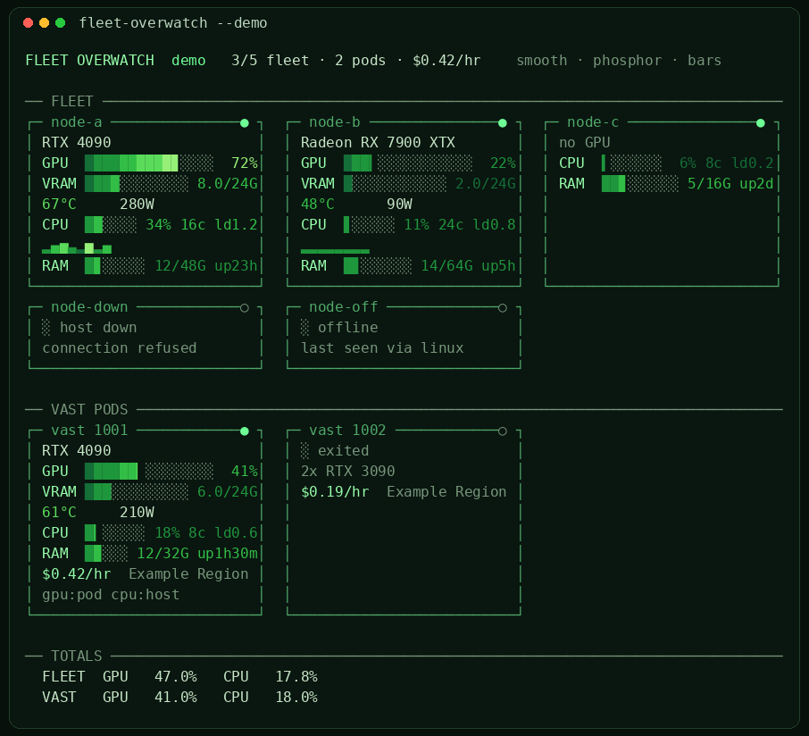

# Fleet Overwatch

Author: Frosty40

[](https://github.com/newjordan/overwatch/actions/workflows/ci.yml)

A terminal panel for live **GPU and CPU activity across a Tailscale fleet**, plus optional **Vast.ai** rentals. One process discovers tailnet devices, polls each over SSH, and draws a refreshing grid. Offline peers and hosts that do not answer SSH stay on screen as grey tiles. The rest of the fleet keeps updating.

The screenshot above is the fictional fleet from demo mode (metric-bars view). It is not a live tailnet.

```
❬ FLEET OVERWATCH · DEMO ❭   3/5 fleet · 2 pods · $0.42/hr   ▞ smooth ◂+/-▸ ▦ phosphor ◂c▸

┌─ node-a ─────────────● ┐ ┌─ node-b ─────────────● ┐ ┌─ node-down ──────────○ ┐
│ RTX 4090               │ │ Radeon RX 7900 XTX    │ │ ░ host down            │
│ GPU  ███████░░░   72%  │ │ GPU  ██░░░░░░░░   22% │ │ connection refused     │
│ CPU  34% 16c ld1.2     │ │ CPU  11% 24c ld0.8    │ └────────────────────────┘
└────────────────────────┘ └───────────────────────┘
```

## Try it with no fleet

Demo mode draws placeholder hosts. It does not call Tailscale, SSH, `nvidia-smi`, or `rocm-smi`.

```bash
git clone https://github.com/newjordan/overwatch && cd overwatch
python3 overwatch.py --demo --once    # one frame, then exit
python3 overwatch.py --demo           # live panel (q quits, g toggles bars/gauges)
```

Nothing in the demo is a real machine. Names are `node-a`, `node-b`, and similar. Addresses are `192.0.2.0/24` (TEST-NET-1, RFC 5737).

## Install

Python 3.9 or newer. The panel itself has no third-party dependencies.

```bash
pip install .
fleet-overwatch --demo --once
```

From a git checkout the launcher still works without installing:

```bash
./overwatch --demo --once
./overwatch.py --once          # real fleet, one frame
```

Development install, then the test suite:

```bash
pip install -e ".[dev]"
pytest
```

GitHub Actions runs that suite on Python 3.10, 3.12, and 3.13. The tests mock `nvidia-smi`, `rocm-smi`, and `tailscale status --json`, so CI does not need GPUs or a tailnet.

## A real tailnet

With no config file, every Linux device in `tailscale status` is probed as the current user. Normal SSH configuration still applies. Copy the example when you want per-node users, order, or labels:

```bash
mkdir -p ~/.config/fleet-overwatch
cp config.example.json ~/.config/fleet-overwatch/config.json
$EDITOR ~/.config/fleet-overwatch/config.json
```

`config.example.json` uses placeholder names (`node-a`, `phone`, `windows-peer`). Replace them. Two more starters live in `templates/`:

```bash
cp templates/fleet-basic.json ~/.config/fleet-overwatch/config.json
cp templates/vast-only.json ~/.config/fleet-overwatch/config.json
```

Search order: `--config PATH`, `$FLEET_OVERWATCH_CONFIG`, `./overwatch.config.json`, `~/.config/fleet-overwatch/config.json`. Every key is optional.

| key | meaning |
| --- | --- |
| `ssh_users` | `{node-name: login}` — the one fact Tailscale cannot supply |
| `default_user` | login for unlisted nodes (`null` = ssh's own default) |
| `gpu_labels` | cosmetic GPU name when no tool can be queried |
| `exclude` | tailnet device names to hide |
| `order` | preferred tile order; unknown nodes follow, alphabetically |
| `vast_key` | SSH key for Vast pods (default `~/.ssh/fleet_overwatch_ed25519`) |
| `vast_user` | SSH login for Vast pods (usually `root`) |
| `tailscale_paths` | candidate tailscale binaries (`null` = PATH plus common WSL paths) |
| `vastai_paths` | candidate vastai binaries (`null` = PATH and `~/.local/bin/vastai`) |

## Flags

```
--demo               fictional fleet; no Tailscale, SSH, or Vast calls
--once               one plain-text frame, then exit
--interval N         refresh seconds (default 2.5)
--nodes a,b          subset of fleet nodes
--only fleet|vast    one source only
--no-vast            hide pods
--theme/--scheme/--gauge/--field NAME
--config PATH        explicit config file
--vast-attach        attach the fleet key to running pods, then exit
--no-vast-attach     disable the auto-heal attach pass
```

Start on a chosen look:

```bash
./overwatch.py --theme circuit --scheme cyber --gauge grid --field helix
```

Keys: `q` quit · `+`/`-` bar theme · `c`/`C` color scheme · `v`/`V` gauge · `f`/`F` totals field · `g` gauge or bars.

## Looks

Choices persist in `~/.config/fleet-overwatch/prefs.json`.

- **24 bar themes** (`+`/`-`): gradient, smooth, shaded, scanline, signal, plasma, spectrum, wave, segmented, pulse, double, brick, rocket, dither, typer, comet, heartbeat, waterfall, matrix, packets, glitch, hex, circuit, hazard
- **8 color schemes** (`c`/`C`): phosphor (default), ember, cyber, ice, rainbow, amber, vapor, mono. The body stays calm and snaps to the redline at 90% or above
- **24 gauge styles** (`v`/`V`): braille dials, square frames, and the angular HUD set. Each dial shows GPU and CPU together
- **5 totals fields** (`f`/`F`): beat, helix, rain, wave, sync

## How it works

- **Tailscale from end to end.** Discovery, liveness, and addresses come from `tailscale status --json`. SSH uses the tailnet address read on that sweep. The repo does not contain real hostnames or addresses. WSL finds `tailscale.exe` on the Windows host when it is there.
- **One probe per machine.** A POSIX shell script prints `nvidia-smi` or `rocm-smi` output, or reads Intel Arc/Xe sysfs, plus `/proc/stat`, load, memory, and uptime. The panel parses that text locally. Probes run in a thread pool with a per-host timeout.
- **A host that is down stays a tile.** Tailscale peers with `Online: false` render as offline and are not probed. A peer that is online but refuses SSH, times out, or has no route renders as **host down** with a short reason. That failure is not printed as a traceback and does not cancel the other hosts. If `tailscale status` itself fails, the last good frame stays up.
- **CPU% is a delta** between two `/proc/stat` samples, not a since-boot average. A per-core strip shows the same delta.
- **GPUs.** NVIDIA via `nvidia-smi` (utilization, VRAM, temperature, power, including more than one card). AMD via `rocm-smi` CSV, the `GPU[n]` key/value listing, or the concise table. Intel Arc/Xe via sysfs. A machine with none of those still shows CPU and RAM.
- **Vast.ai pods** come from `vastai show instances-v1`. Per-GPU numbers prefer SSH. If SSH fails, lagged API numbers are labeled as such. CPU and RAM for a pod come from the API, because `/proc` inside the container is the whole host.
- **Render errors** become an error tile plus a line in `~/.cache/fleet-overwatch-error.log`. If curses cannot start, the panel falls back to a plain refreshing frame.

## Vast.ai key setup

Vast does not inject account SSH keys into new pods. `./vast-setup.sh` creates one passphrase-less fleet key, registers it, copies it to the hosts listed in your config, and attaches it to running pods. Later scans attach the same key to any pod the panel cannot reach.

The fleet key has no passphrase, so treat it as a low-value credential for ephemeral rentals. Host-key checking is disabled for Vast pods only, because those hosts are short-lived.

## Requirements

- Python 3.9+ on the machine running the panel.
- POSIX shell and `/proc` on each probed Linux host.
- Non-interactive SSH (Tailscale SSH, keys, or an agent).
- Optional: the `tailscale` CLI for the fleet section, and `vastai` (`pipx install vastai`) for pods.
- A monospace font with box drawing, blocks, and braille.

## Tests

```bash
pytest
```

`tests/` feeds fixture stdout from `nvidia-smi`, `rocm-smi`, and `tailscale status --json` through the parsers, checks that a refused or timed-out host becomes a down tile without dropping its neighbors, and runs `--demo --once` with process execution blocked.

Regenerate the README image after a rendering change:

```bash
pip install pillow
python3 scripts/render_demo_screenshot.py
```

## License

MIT — see [LICENSE](LICENSE).

```text
⠀⠀⠀⠀⠀⠀⠀⠀⠀⣀⠤⠚⠓⠤⣀⠀⠀⠀⠀⠀⠀⠀⠀⠀
⠀⠀⠀⠀⠀⠀⠀⠀⡾⣅⠀⠀⠀⠀⣨⢷⠀⠀⠀⠀⠀⠀⠀⠀
⠀⠀⣀⡤⡦⣄⡀⠀⡇⠀⠙⢢⡔⠋⠀⢸⠀⢀⣠⢴⢤⣀⠀⠀
⡴⠊⠁⠀⢷⠀⠉⠲⣇⠀⠀⢸⡇⠀⠀⣸⠖⠉⠀⡼⠀⠈⠑⢦
⣧⠀⠀⢀⣸⡀⠀⠀⢿⠙⠲⢼⣧⠖⠋⡿⠀⠀⢀⣇⡀⠀⠀⣸
⢹⡴⠚⠉⠀⠈⠑⠦⣼⠀⠀⢸⡇⠀⠀⣧⡴⠊⠁⠀⠉⠓⢦⡏
⠀⠈⠓⢤⣀⡤⠖⠋⠁⠙⠲⣼⣧⠖⠋⠈⠙⠲⢤⣀⡤⠚⠁⠀
⢀⡠⠖⠉⠀⠉⠓⠦⣄⠴⠚⢹⡏⠓⠦⣠⡴⠚⠉⠀⠉⠲⢄⡀
⣼⠙⠲⢤⣀⡠⠔⠋⢹⠀⠀⣸⣇⠀⠀⣏⠙⠲⢄⣀⡤⠖⠋⣧
⡏⠀⠀⠀⢸⠀⠀⠀⣿⠴⠚⢹⡏⠓⠦⣿⠀⠀⠀⡇⠀⠀⠀⢸
⠙⠢⣄⡀⡟⣀⡤⠚⡇⠀⠀⢸⡇⠀⠀⢸⠓⠤⣀⢹⢀⣠⠔⠋
⠀⠀⠀⠉⠋⠁⠀⠀⡇⣀⠴⠊⠑⠦⣀⢸⠀⠀⠈⠙⠉⠀⠀⠀
⠀⠀⠀⠀⠀⠀⠀⠀⠻⣅⠀⠀⠀⠀⣨⠟⠀⠀⠀⠀⠀⠀⠀⠀
⠀⠀⠀⠀⠀⠀⠀⠀⠀⠀⠉⠲⠖⠉⠀⠀⠀⠀⠀⠀⠀⠀⠀⠀
```
